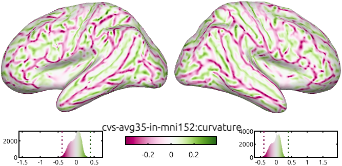
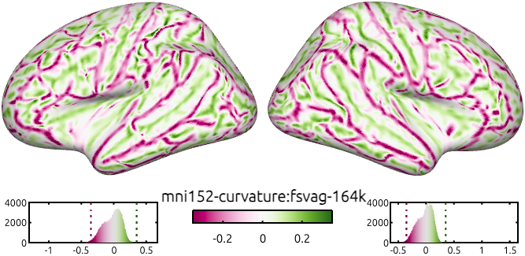
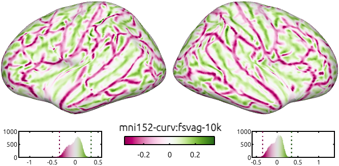
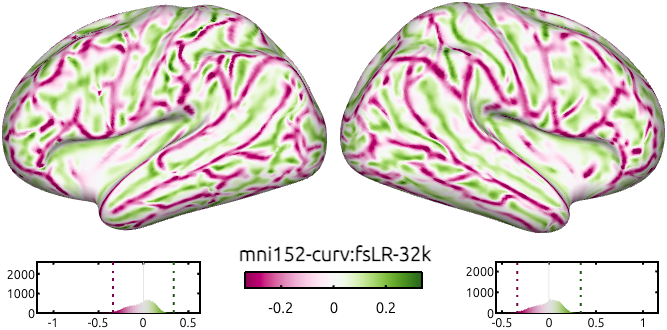
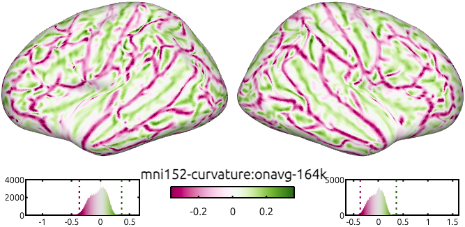

I still feel a bit of bittersweet nostalgia when it comes to debates about which template is better and why. After all, my template is always the best. It's just that others don't know it! 🤓 Because of my emotional attachment to Heschl's sulcus, I definitely prefer very inflated surfaces (like `fsaverage6`, a.k.a. `fsavg-ico6-64k`), but people working on vision or motor control may not care about the Sylvian fissure at all! 🥲

Here I'm plotting curvature mapped onto different template surfaces to see how well they are aligned and how well each surface look.

## cvs_avg35_inMNI152

**How was it created?** This template was created using combined volumetric and surface (CVS) morphing ([Postelnicu et al., 2009, _IEEE Transactions on Medical Imaging_](https://doi.org/10.1109/tmi.2008.2004426)), presumably based on T1-weighted images from 35 (healthy?) participants in [Desikan et al., 2006, _NeuroImage_](https://doi.org/10.1016/j.neuroimage.2006.01.021), and then further registered to the MNI152 template (which one though?). However, the demographics of these 35 participants are unclear. Desikan et al.'s original sample comprised 40 participants: 10 young adults (19–24 years), 10 middle-aged adults (41–57 years), 10 older adults (66–87 years), and 10 patients with Alzheimer's disease. (Hmmph!)

**Where can you find it?** It is included in FreeSurfer: <https://surfer.nmr.mgh.harvard.edu/>. After installation, you can find it at: `$FREESURFER_HOME/subjects/csv_avg35_inMNI152`.

|  |
| _Fig 1. Gaussian curvature of the `cvs_avg35_inMNI152`'s white surfaces (~137k)._ |

 

## fsaverage

**How was it created?** This FreeSurfer template was created using data from 40 participants (all healthy?). Over successive releases, the algorithms have been improved, and manual corrections have been made iteratively (see [Buckner40 notes](https://surfer.nmr.mgh.harvard.edu/fswiki/Buckner40Notes)). These are likely the same 40 participants reported in the seminal paper ([Fischl et al., 1999, _Human Brain Mapping_](<https://doi.org/10.1002/(SICI)1097-0193(1999)8:4%3C272::AID-HBM10%3E3.0.CO;2-4>)). Given the name "Buckner40", there may also be some overlap with the 36 healthy participants (aged 18–35 years) studied in [Buckner et al., 1998, _Neuron_](<https://doi.org/10.1016/S0896-6273(00)80456-0>).

**Where can you find it?** It is included in FreeSurfer: <https://surfer.nmr.mgh.harvard.edu/>. After installation, you can find it at: `$FREESURFER_HOME/subjects/fsaverage*`. The original surface `fsaverage` is the highest density (164k vertices per hemisphere). fsaverage3 (642 vertices) fsaverage4 (2562 vertices) fsaverage5 (10k) fsaverage6 (41k)

|  |
| _Fig 2. CVS-AVG35 curvature mapped onto `fsaverage-164k`._ |

|  |
| _Fig 3. CVS-AVG35 curvature mapped onto `fsaverage6-41k`._ |

 

## fs_LR

**How was it created?** This symmetric template was originally created by registering `fsaverage` surfaces across hemispheres using a modified surface-based registration method that focused on manually identified neuroanatomical landmarks rather than entire sulcal maps ([Van Essen et al., 2012, _Cerebral Cortex_](https://doi.org/10.1093/cercor/bhr291)). Interestingly, the 'very inflated' surface presented in this paper appears even rounder than the `very-inflated` surface available on the [TemplateFlow](https://www.templateflow.org/) platform, and even rounder than that of `fsaverage6` (41k vertices).

**Where can you find it?** This template was popularised through the success of the [Human Connectome Project (HCP)](https://www.humanconnectome.org/) (e.g., [Glasser et al., 2016, _Nature_](https://doi.org/10.1038/nature18933); see [Elam et al., 2021, _NeuroImage_](https://doi.org/10.1016/j.neuroimage.2021.118543) for a retrospective), as it was included as a standard surface template in the HCP's official visualisation tool:
<https://www.humanconnectome.org/software/connectome-workbench>. It is also available through the TemplateFlow platform, developed by Russell Poldrack and colleagues ([Ciric et al., 2022, _Nature Methods_](https://doi.org/10.1038/s41592-022-01681-2)): <https://www.templateflow.org/>.

|  |
| _Fig 4. CVS-AVG35 curvature mapped onto `fs_LR`._ |

 

## onavg

**How was it created?** This template was created by averaging a large-scale anatomical dataset (N = 1,031) publicly available through the [OpenNeuro](https://openneuro.org/) platform (*OpenNeuro Average*, `onavg`; [Feilong et al., 2024, *Nature Methods*](https://doi.org/10.1038/s41592-024-02346-y)). The participants were approximately gender-balanced (471 females, 408 males, 2 non-binary individuals, and 150 with unknown gender). The mean age ± standard deviation was 28.42 ± 14.57 years, with an age range of 8–81 years.
According to the paper, this template has more uniform mesh triangulation than `fsaverage`, whose triangulation distortion is well known because the FreeSurfer surface mesh is derived from a subdivided icosahedron fitted to a sphere (see [my previous post](https://seunggookim.github.io/blog/2025/surf/)). In other words, FreeSurfer's triangles are nearly uniform on a sphere, but they become distorted as the mesh is deformed to fit the white or grey matter boundary. Therefore, a cortical surface mesh with more uniform triangulation may be preferable for analyses involving local neighbourhoods (e.g., searchlight analysis).

**Where can you find it?** See the authors' page: <https://feilong.github.io/tpl-onavg/>.

|  |
| _Fig 5. CVS-AVG35 curvature mapped onto `onavg-164k`._ |

 

## Van Essen's flattened surfaces

## Gallant's flattened surfaces
