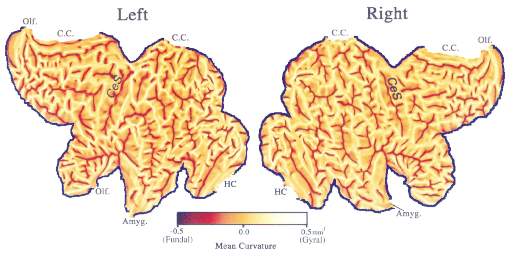
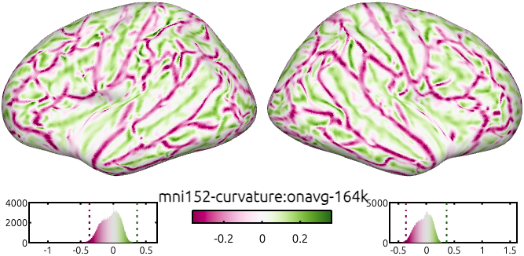
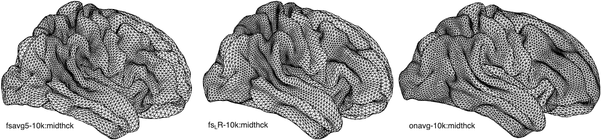
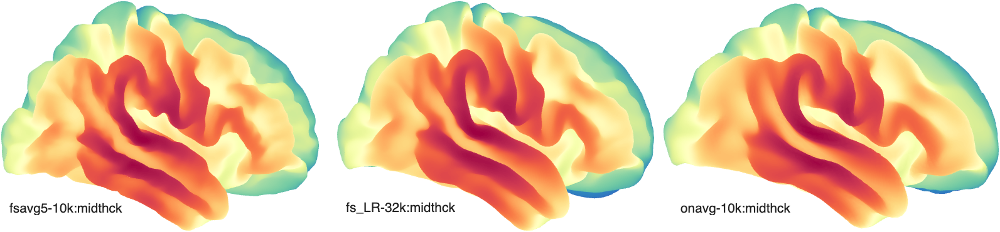

As promised, here is some more yapping about map-making (cartography). While I have no training in visual design or cartography, I heard that graphic design is about making deliberate choices for specific purposes, because there is no such a thing as "faithful" visualisation. There are only choices and purposes. Mathematically, you cannot flatten a spherical surface into a 2D map without geometric distortion (such as stretching or compression) and/or making cuts to open up the surface, which changes the topology. So, we have to choose which distortions and cuts best serve our purpose.

## Flatland

["Flatland: A Romance of Many Dimensions"](https://en.wikipedia.org/wiki/Flatland) is a short novel published in 1884 in London about geometric figures living in a 2D world 'Flatland'.
Its protagonist, the Square, dreams of the one-dimensional world 'Lineland' and later visits the three-dimensional world 'Spaceland'.
He is eventually imprisoned for preaching the existence of a third dimension.
I first came across the book through a reference in the article ["The Flatland Fallacy"](https://doi.org/10.1111/tops.12404).
Although I still haven’t read it, I always think of this book when thinking about data visualisation.

Because how our eyes relay on the 2D projection of lights reflected from 3D objects on our retinas, we cannot perceive a 3D view itself from one view point but have to reconstruct based on depth cues (occlusion, binocular disparity), focus, movement, rotation, lighting and so on.
Our display media are still mainly two-dimensional (flat or curved displays or paper).
Even with holographic displays or binocular goggles, we cannot perceive the full 3D structure of an object from a single static viewpoint. Thus, the visualisation of higher-dimensional data requires various tricks, each of which comes with its own costs.

## Van Essen's flatmap

It has been well known that (i) the human cerebral cortex is highly convoluted and folded, and (ii) the cortex is organised in such a way that adjacent cortical regions along the curved surface tend to serve similar functions (i.e., geodesic proximity is associated with functional similarity). The former must have been known from the very early human history because you can see this when you open the skull. The latter became common knowledge through early electrical stimulation and lesion experiments in Germany in the late 1800s (e.g., by Gustav Fritsch, Eduard Hitzig, and Hermann Munk).

Thus, if you spend enough time looking at the brain, you may find yourself wanting to unfold the cortex and see its entire surface at a glance.
This desire is nicely illustrated in the work of [Hubel and Wiesel (1972)](https://doi.org/10.1002/cne.901460402), who each received a quarter of the 1981 Nobel Prize in Physiology or Medicine "for their discoveries concerning information processing in the visual system" [[link](https://www.nobelprize.org/prizes/medicine/1981/summary/)]:

|  |
| _Fig 1. A parasigittal section of a monkey's occipital lobe and the reconstructed (unfolded) layer IV c. [(Hubel and Wiesel, 1972)](https://doi.org/10.1002/cne.901460402)_ |

But I want to talk about David C. Van Essen (the mastermind behind the Human Connectome Project). There could be earlier papers presenting similar ideas, but [Van Essen's paper](https://doi.org/10.1002/cne.901910208) first proposed a whole-brain unfolding method in 1980:

|  |
| _Fig 2. How to unfold a macaque brain [(Van Essen et al., 1980)](https://doi.org/10.1002/cne.901910208)._ |

Now, this reminds me of a chef’s deboning technique, in which a whole chicken is turned into a flattened, boneless piece of meat. 👨‍🍳

The year 1980 was pretty too early to computerise this idea. The state-of-art graphics can only support 512 pixel x 512 pixel x 8 bit in late 1970s. The first human head MRI was acquired by Siemens in 1980.
So, 17 years later, [Van Essen & Drury](https://doi.org/10.1523/JNEUROSCI.17-18-07079.1997) finally published the flat maps of the human cortex:
|  |
|  |
| _Fig 3. Flat maps of the human cortex [(Van Essen & Drury, 1980)](https://doi.org/10.1523/JNEUROSCI.17-18-07079.1997)._ |

Thess flat maps showed up again in Glasser's HCP multi-modal parcellation (HCP*MMP1.0):
|  |
| \_Fig 4. XXX.* |

## Gallant's flatmap

<!--
## onavg

**How was it created?** This template was created by averaging a large-scale anatomical dataset (N = 1,031) publicly available through the [OpenNeuro](https://openneuro.org/) platform (_OpenNeuro Average_, `onavg`; [Feilong et al., 2024, Nature Methods](https://doi.org/10.1038/s41592-024-02346-y)). The participants were approximately gender-balanced (471 females, 408 males, 2 non-binary individuals, and 150 with unknown gender). The mean age ± standard deviation was 28.42 ± 14.57 years, with an age range of 8–81 years.
According to the paper, this template has more uniform mesh triangulation than `fsaverage`, whose triangulation distortion is well known because the FreeSurfer surface mesh is derived from a subdivided icosahedron fitted to a sphere (see [my previous post](https://seunggookim.github.io/blog/2025/surf/)). In other words, FreeSurfer's triangles are nearly uniform on a sphere, but they become distorted as the mesh is deformed to fit the white or grey matter boundary. Therefore, a cortical surface mesh with more uniform triangulation may be preferable for analyses involving local neighbourhoods (e.g., searchlight analysis).

**Where can you find it?** See the authors' project project page: <https://feilong.github.io/tpl-onavg/>. On the TemplateFlow, the authors have uploaded only the spherical surfaces for registration (including an ultra-high-resolution sphere with ~655k vertices, like ~0.5 mm edges?).

|  |
| _Fig 5. CVS-AVG35 curvature mapped onto `onavg-164k_inflated`._ |

|  |
| _Fig 6. Wireframes of `fsaverage5-10k_midthickness` (left), `fs_LR-10k_midthickness` (middle) and `onavge-10k_midthickness` (right)._ |

|  |
| _Fig 7. X-coordinates of `fsaverage-164k_midthickness` (left), `fs_LR-32k_midthickness` (middle) and `onavge-164k_midthickness` (right)._ |

 

## Related posts

[Surfing LEA 🏄‍♀️👧](https://seunggookim.github.io/blog/2025/surf/)

Flatland (TBD) -->
