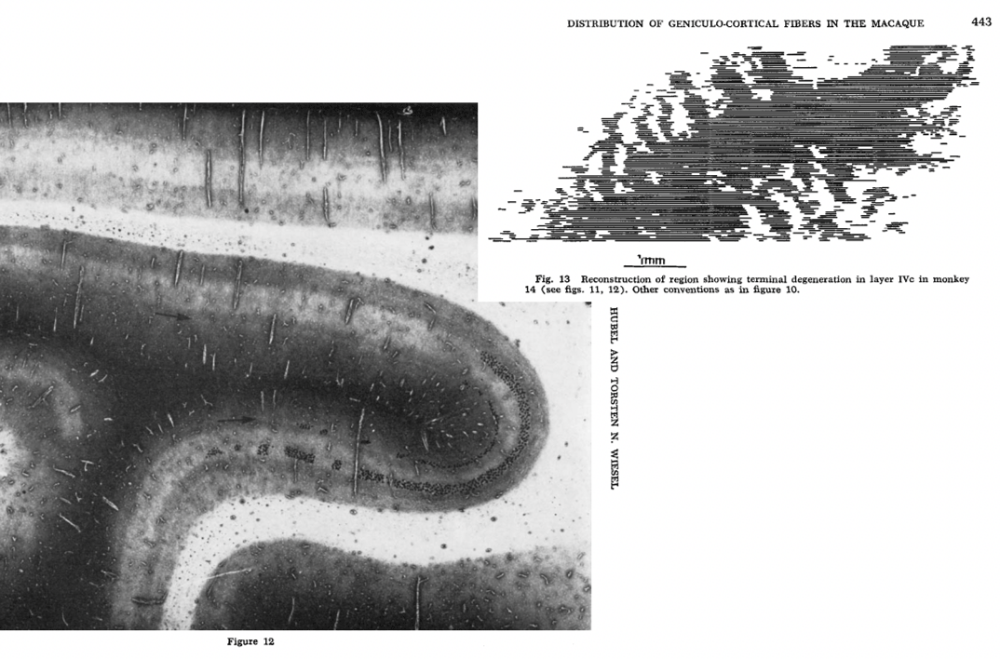
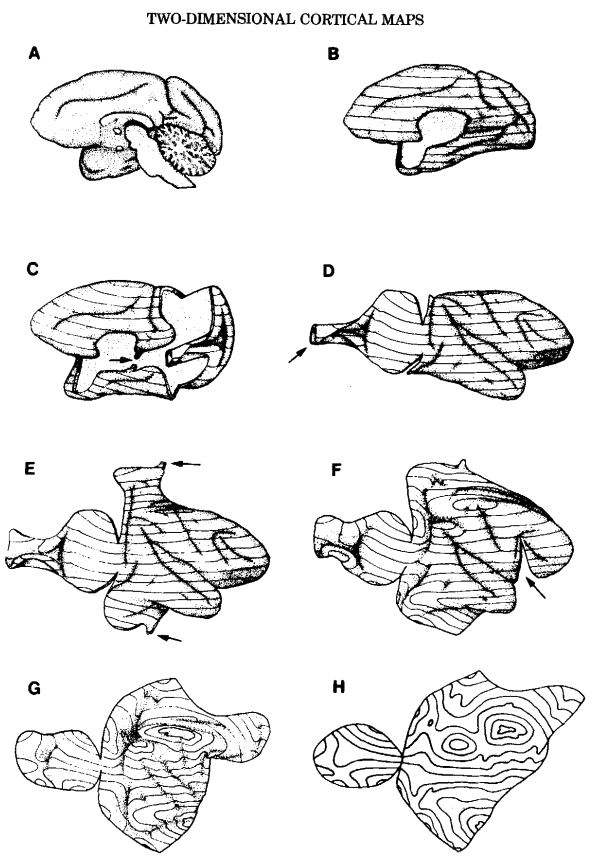
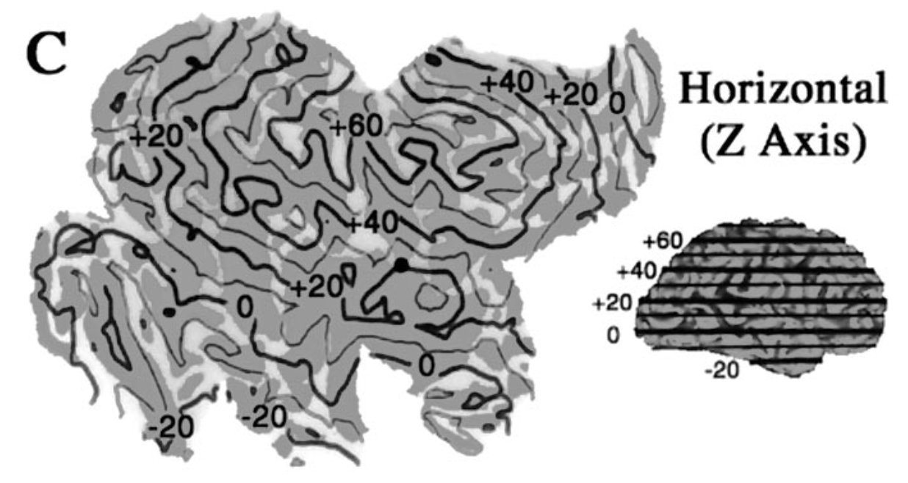
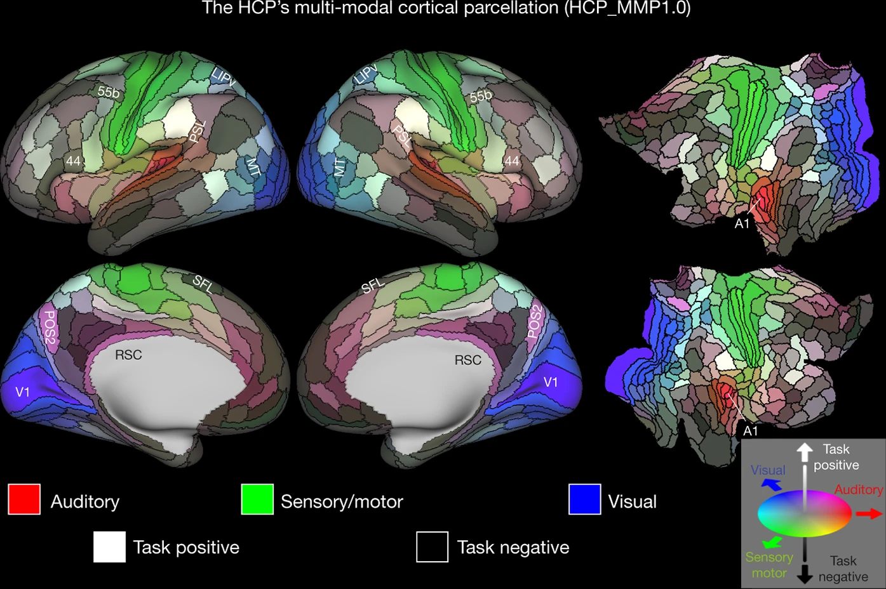
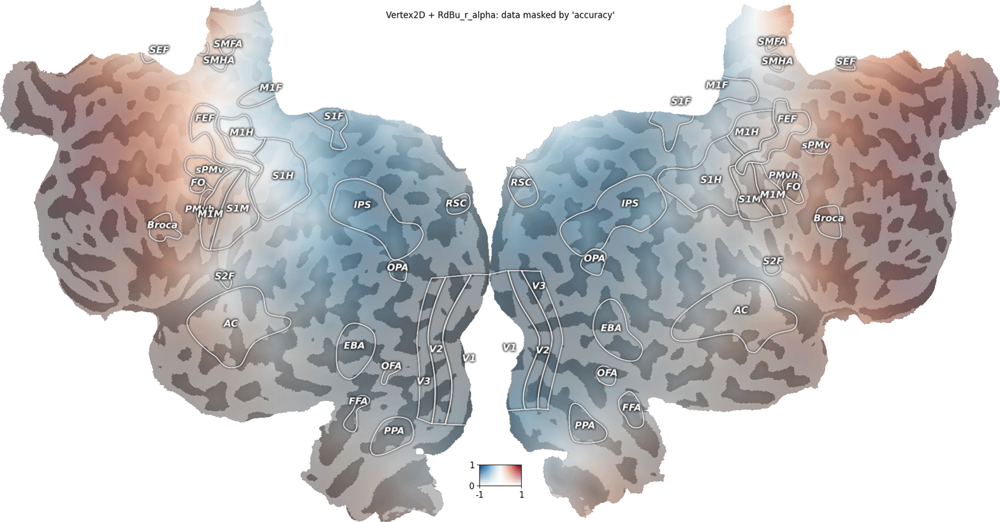
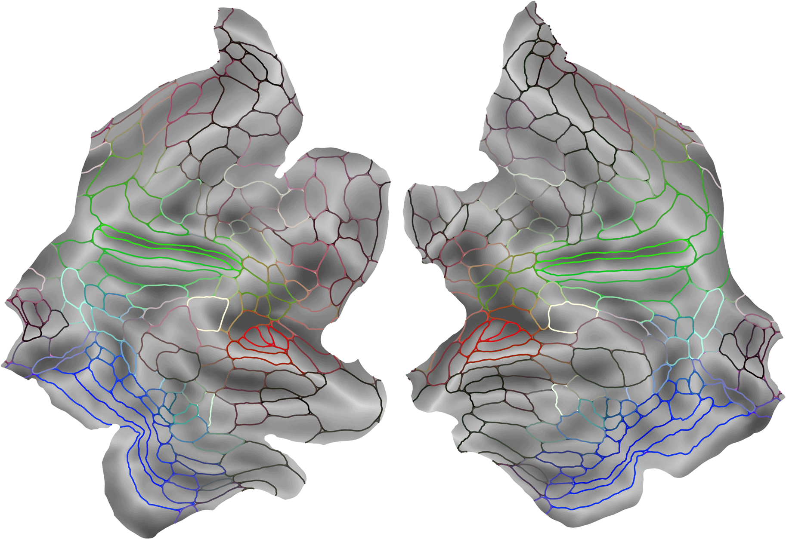
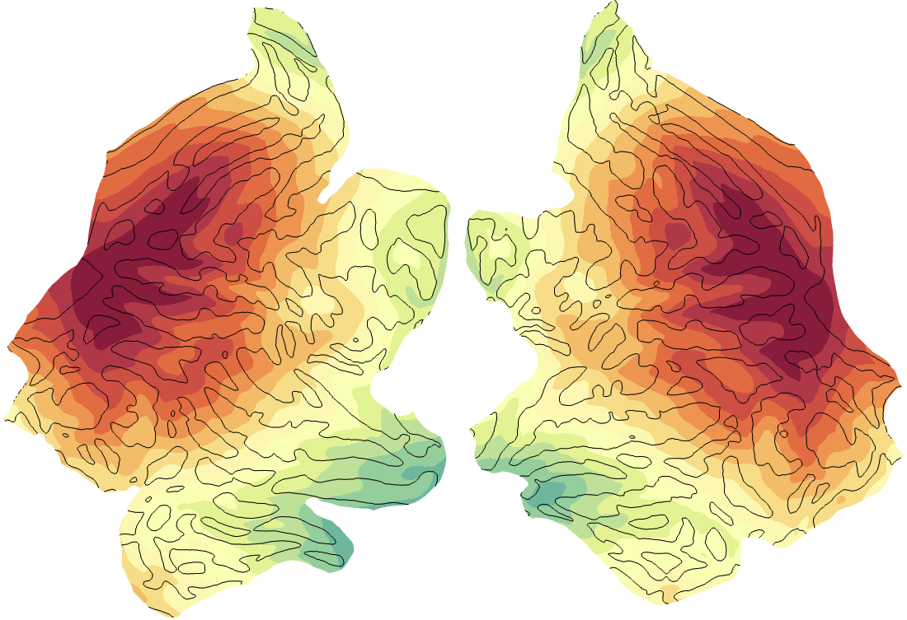

As promised, here is some more yapping about map-making (cartography). While I have no training in visual design or cartography, I heard that graphic design is about making deliberate choices for specific purposes, because there is no such a thing as "faithful" visualisation. There are only choices and purposes. Mathematically, you cannot flatten a spherical surface into a 2D map without geometric distortion (such as stretching or compression) and/or topological distortion (making cuts to open up the surface). So, we have to choose which distortions and cuts best serve our purpose.

## Flatland

["Flatland: A Romance of Many Dimensions"](https://en.wikipedia.org/wiki/Flatland) is a short novel published in 1884 in London about geometric figures living in a 2D world 'Flatland'.
Its protagonist, the Square, dreams of the one-dimensional world 'Lineland' and later visits the three-dimensional world 'Spaceland'.
He (yes, in Flatland, men are polygons and women are line segments) is eventually imprisoned for preaching the existence of a third dimension.
I first came across the book through a reference in this inspiring article ["The Flatland Fallacy: Moving Beyond Low–Dimensional Thinking"](https://doi.org/10.1111/tops.12404).
Although I still haven’t read it, I always think of this book when thinking about data visualisation.

Because how our eyes relay on the 2D projection of lights reflected from 3D objects on our retinas, we cannot perceive a 3D object itself from one static view point, but have to reconstruct it based on depth cues (occlusion, binocular disparity, focus), movement, rotation, lighting and so on.
Our display media are still mainly two-dimensional (flat or curved displays or paper).
Even with holographic displays or binocular goggles, we cannot perceive the full 3D structure of an object from a single static viewpoint. Thus, the visualisation of higher-dimensional data requires various tricks, each of which comes with its own costs.

## Van Essen's flatmap

It has been well known that (i) the human cerebral cortex is highly convoluted and folded, and (ii) the cortex is organised in such a way that adjacent cortical regions along the curved surface tend to serve similar functions (i.e., geodesic proximity is associated with functional similarity). The former must have been known from the very early human history because you can see this when you open the skull. The latter became common knowledge through early electrical stimulation and lesion experiments in Germany in the late 1800s (e.g., by Gustav Fritsch, Eduard Hitzig, and Hermann Munk).

Thus, if you spend time looking at the brain long enough, you may find yourself wanting to unfold the cortex and see its entire surface at a glance.
This desire is nicely illustrated in the work of [Hubel and Wiesel (1972)](https://doi.org/10.1002/cne.901460402), who each received a quarter of [the 1981 Nobel Prize in Physiology or Medicine](https://www.nobelprize.org/prizes/medicine/1981/summary/) "for their discoveries concerning information processing in the visual system":

_Fig 1. A parasigittal section of a monkey's occipital lobe and the reconstructed (unfolded) layer IV c. ([Hubel and Wiesel, 1972](https://doi.org/10.1002/cne.901460402))_

 

But I want to talk about David C. Van Essen (the mastermind behind the Human Connectome Project). There could be earlier literature presenting similar ideas, but [Van Essen et al. (1980)](https://doi.org/10.1002/cne.901910208) first proposed a whole-brain unfolding method in 1980:

_Fig 2. How to unfold a macaque brain ([Van Essen et al., 1980](https://doi.org/10.1002/cne.901910208))._

 

Now, this reminds me of a chef’s deboning technique, in which a whole chicken is turned into a flattened, boneless piece of meat. 👨‍🍳

The year 1980 was pretty too early to computerise this idea. The state-of-art graphics can only support 512 pixel x 512 pixel x 8 bit in late 1970s. The first human head MRI was acquired by Siemens in 1980.
So, 17 years later, [Van Essen & Drury](https://doi.org/10.1523/JNEUROSCI.17-18-07079.1997) finally published software that generates the flat maps of the living human cortex using MRI data, called CARET (Computerized Anatomical Reconstruction Toolkit):

_Fig 3. Flat maps of the human cortex ([Van Essen & Drury, 1980](https://doi.org/10.1523/JNEUROSCI.17-18-07079.1997))._

 

These flat maps made another appearance in Glasser's Human Connectome Project Multi-modal parcellation (HCP-MMP1.0):

_Fig 4. HPC-MMP1 visualisation ([Glasser et al., 2016](https://doi.org/10.1038/nature18933))._

 

## Gallant's flatmap

However, except among a few Flat Brain enthusiasts, flat maps have not been widely used. More common visualisations to this day are still 2D slice montages and multi-view rendering of the 3D models of inflated brains (first FreeSurfer's inflated surfaces, then fs_LR's less-inflated surfaces).

Then, unexpectedly, I encountered a new flat map in a very narrow field of cognitive neuroscience called "naturalistic neuroimaging". [Pycortex](https://gallantlab.org/pycortex/index.html) was developed in Jack Gallant's lab. Then it seems that it has attracted less-neuroscience-more-datascience researchers, possibly due to the fact that this scheme renders each data point only once (unlike the multi-view display):

_Fig 5. Example of PyCortex visualisation (<https://gallantlab.org/pycortex/>)._

 

Even people who don't know about Van Essen's flat maps use Gallant's flat maps, which I find very interesting!
Of course, the idea of peeling something cannot in itself be so original (monkeys know how to peel oranges!).
Perhaps Van Essen himself got the idea from Japanese Origami. Or maybe at a butcher's shop. Or maybe from a TV cooking show. Or maybe from animal skinning techniques.
And the Pycortex paper ([Gao et al., 2015](https://doi.org/10.3389/fninf.2015.00023)) explicitly acknowledges existing visualisation software (including Van Essen's CARET) and attributes its advances to the integration of Python and WebGL.

But still I wonder if (and why) data scientists think this visualisation is a cool idea. 🤔 Do they get excited about the preservation of geodesic proximity and functional relevance? Also, aren't they bothered by the visual-centric view of this map? 😈

## Onavg flatmap

> "The brain is flat, and it's surrounded by an ice wall!" (says no one)

So, I created an auditory-centric flat map using the onavg (OpenNeuro Average) template surfaces:

_Fig 6. (Top) Sulcal depth projected on the flattened onavg surfaces (164k vertices per hemisphere) overlaid with coloured contours of HPC-MMP1 regions (RED=auditory, GREEN=sensory/motor, BLUE=visual, WHITE=task positive, BLACK=task negative). (Bottom) Z-coordinates (inferior-to-superior) of the white surfaces projected, with zero-curvature contours._

 

It's just Van Essen's flat maps (<https://balsa.wustl.edu/reference/pkXDZ>) applied to the onavg surfaces and rotated so that the frontotemporal areas are placed in the middle of the figure.

As you can see, the patch on the left is the right hemisphere, and vice versa, which could be potentially confusing. So, I'm still thinking about what to do with the left/right arrangement. It's either this or rotating the whole thing by 180 degrees, so that you have the left hemisphere on the left, but then it's upside down (e.g., the STG is below the MTG). Another option is to mirror the whole thing as if you were looking from the inside rather than the outside. I mean, I can imagine rolling the flattened patches back up over my head while standing between the surfaces (like wearing a Mission-Impossible-style mask). But well... I don't know.

If you're interested, you can download the flat maps (`.gii`) from here (version 2): <https://doi.org/10.5281/zenodo.24243148>

## Related posts

[Surfing LEA 🏄‍♀️👧](https://seunggookim.github.io/blog/2025/surf/)

[Lots of surfs 🏄‍♀️🏄‍♂️🏄](https://seunggookim.github.io/blog/2026/surfs/)
